# 스프링부트 REST API by TDD — 글/댓글 CRUD

> 테스트를 먼저 쓰고(🔴 Red), 통과시키고(🟢 Green), 다듬는(🔵 Refactor) 과정을 **커밋 하나하나**로 남긴 학습용 저장소입니다.
> 모든 커밋에는 `001`, `002` … 처럼 **태그**가 붙어 있어서 아래 링크를 누르면 해당 단계의 변경 내용으로 바로 이동합니다.

  

## 목차
- [과제](#과제)
- [기술 스택과 실행 방법](#기술-스택과-실행-방법)
- [커밋 따라가는 방법](#커밋-따라가는-방법)
- [전체 구조 한눈에 보기](#전체-구조-한눈에-보기)
- [API 명세](#api-명세)
- [단계별 커밋 가이드](#단계별-커밋-가이드)
  - [1부. 프로젝트 세팅과 엔티티 (001 ~ 005)](#1부-프로젝트-세팅과-엔티티-001--005)
  - [2부. 샘플 데이터 by TDD (006 ~ 007)](#2부-샘플-데이터-by-tdd-006--007)
  - [3부. 글 API by TDD (008 ~ 023)](#3부-글-api-by-tdd-008--023)
  - [4부. 댓글 API by TDD (024 ~ 035)](#4부-댓글-api-by-tdd-024--035)
- [최종 테스트 결과](#최종-테스트-결과)
- [핵심 개념 정리](#핵심-개념-정리)

---

## 과제
- [x] 샘플 데이터 : 글 3개, 댓글 5개
- [x] 글 CRUD 엔드포인트 구현 by TDD (다건조회, 단건조회, 작성, 수정, 삭제)
- [x] 댓글 CRUD 엔드포인트 구현 by TDD (다건조회, 단건조회, 작성, 수정, 삭제)
- 참고 : [slog.gg/p/14172 — 스프링부트, REST API by TDD](https://www.slog.gg/p/14172)

---

## 기술 스택과 실행 방법

| 구분 | 사용 기술 |
|---|---|
| 언어 / 빌드 | Java 25, Gradle (Kotlin DSL) |
| 프레임워크 | Spring Boot 4.1.2 (Web MVC, Data JPA, Validation) |
| DB | H2 (개발 : 파일 DB `./db_dev`, 테스트 : 메모리 DB) |
| 테스트 | JUnit 5, MockMvc, AssertJ |
| 기타 | Lombok, DevTools |

```bash
./gradlew test      # 전체 테스트 실행 (17개)
```

```bash
./gradlew bootRun   # 서버 실행 → http://localhost:8080/api/v1/posts
```

- H2 콘솔 : http://localhost:8080/h2-console
  - JDBC URL : `jdbc:h2:./db_dev;MODE=MySQL` / User : `sa` / Password : (빈칸)

---

## 커밋 따라가는 방법

- **GitHub 에서** : 아래 표의 태그 링크(예: [`009`](https://github.com/Minse5k/practice-springbootTDD2/commit/009))를 누르면 그 커밋의 변경 내용(diff)과 **자세한 커밋 메세지**를 볼 수 있습니다.
- **내 PC 에서** : 특정 단계의 코드로 돌아가 직접 실행해볼 수 있습니다.

```bash
git checkout 009    # 009 단계의 코드로 이동 (이 상태에서 ./gradlew test 하면 실패하는 걸 직접 볼 수 있다)
```

```bash
git checkout main   # 최신 코드로 복귀
```

- 커밋 제목의 표시
  - 🔴 **RED** : 실패하는 테스트를 먼저 작성한 커밋 (일부러 실패하는 상태로 커밋)
  - 🟢 **GREEN** : 테스트를 통과시킨 커밋
  - 표시 없음 : 세팅 / 리팩토링 커밋

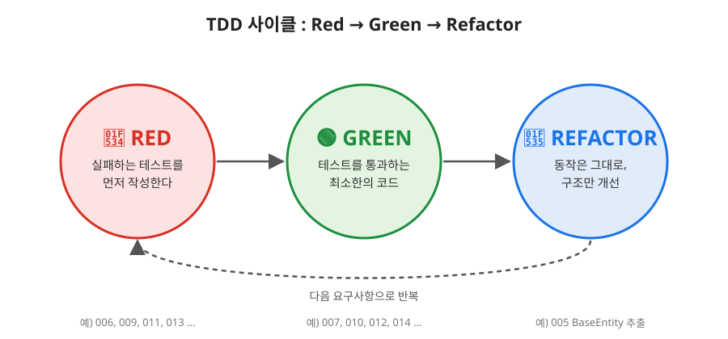

---

## 전체 구조 한눈에 보기

### 요청 처리 흐름
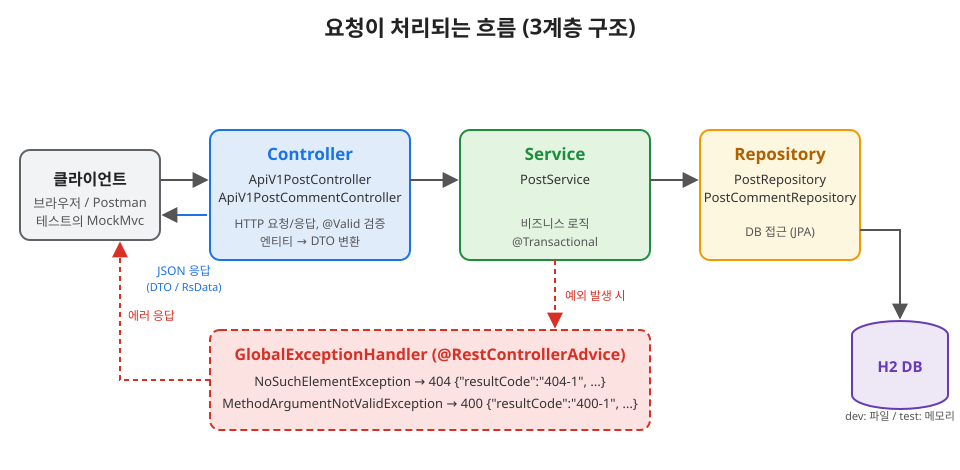

### 테이블과 샘플 데이터
샘플 데이터는 앱이 시작될 때 [`BaseInitData`](src/main/java/com/back/global/initData/BaseInitData.java)가 넣어줍니다.
댓글을 **3개 / 2개 / 0개**로 고르지 않게 나눈 것은, 댓글 목록 조회에서 "빈 목록"까지 확인하기 위해서입니다.

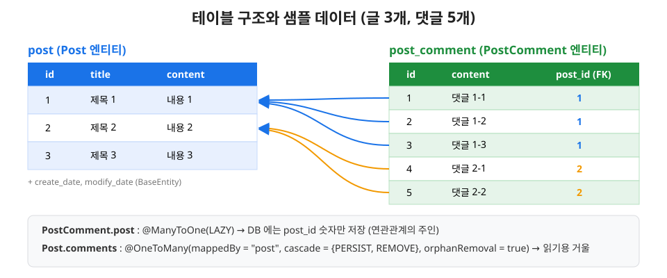

### 패키지 구조
```
src/main/java/com/back
├── BackApplication.java                       # 시작점 + @EnableJpaAuditing
├── domain/post
│   ├── post
│   │   ├── controller/ApiV1PostController.java
│   │   ├── dto/PostDto.java
│   │   ├── entity/Post.java                   # comments(@OneToMany), modify, addComment, deleteComment ...
│   │   ├── repository/PostRepository.java
│   │   └── service/PostService.java           # 글 + 댓글 로직 (댓글은 항상 글을 거쳐서 다룬다)
│   └── postComment
│       ├── controller/ApiV1PostCommentController.java
│       ├── dto/PostCommentDto.java
│       ├── entity/PostComment.java            # post(@ManyToOne LAZY)
│       └── repository/PostCommentRepository.java
└── global
    ├── globalExceptionHandler/GlobalExceptionHandler.java  # 404, 400 공통 처리
    ├── initData/BaseInitData.java             # 샘플 데이터 (글 3, 댓글 5)
    ├── jpa/entity/BaseEntity.java             # id, createDate, modifyDate
    └── rsData/RsData.java                     # { resultCode, msg, data }
```

---

## API 명세

### 글 `/api/v1/posts`
| 기능 | 메서드 | URL | 성공 응답 | 실패 응답 |
|---|---|---|---|---|
| 다건조회 | `GET` | `/api/v1/posts` | 200 `[PostDto, ...]` (최신순) | |
| 단건조회 | `GET` | `/api/v1/posts/{id}` | 200 `PostDto` | 404 `404-1` |
| 작성 | `POST` | `/api/v1/posts` | 201 `201-1` + `data: PostDto` | 400 `400-1` |
| 수정 | `PUT` | `/api/v1/posts/{id}` | 200 `200-1` | 400, 404 |
| 삭제 | `DELETE` | `/api/v1/posts/{id}` | 200 `200-1` (댓글도 함께 삭제) | 404 |

### 댓글 `/api/v1/posts/{postId}/comments`
| 기능 | 메서드 | URL | 성공 응답 | 실패 응답 |
|---|---|---|---|---|
| 다건조회 | `GET` | `/api/v1/posts/{postId}/comments` | 200 `[PostCommentDto, ...]` (최신순) | 404 |
| 단건조회 | `GET` | `/api/v1/posts/{postId}/comments/{id}` | 200 `PostCommentDto` | 404 (다른 글의 댓글이어도 404) |
| 작성 | `POST` | `/api/v1/posts/{postId}/comments` | 201 `201-1` + `data: PostCommentDto` | 400, 404 |
| 수정 | `PUT` | `/api/v1/posts/{postId}/comments/{id}` | 200 `200-1` | 400, 404 |
| 삭제 | `DELETE` | `/api/v1/posts/{postId}/comments/{id}` | 200 `200-1` | 404 |

### 응답 예시
```jsonc
// GET /api/v1/posts/1
{ "id": 1, "createDate": "2026-11-18T15:27:06.762608", "modifyDate": "2026-11-18T15:27:06.762608", "title": "제목 1", "content": "내용 1" }

// POST /api/v1/posts  → 201
{ "resultCode": "201-1", "msg": "4번 글이 작성되었습니다.", "data": { "id": 4, "createDate": "...", "modifyDate": "...", "title": "제목 new", "content": "내용 new" } }

// GET /api/v1/posts/999999  → 404
{ "resultCode": "404-1", "msg": "해당 데이터가 존재하지 않습니다.", "data": null }

// POST /api/v1/posts  { "title": "" }  → 400
{ "resultCode": "400-1", "msg": "title-NotBlank-제목을 입력해주세요.", "data": null }
```

---

## 단계별 커밋 가이드

> 각 커밋 메세지에는 **무엇을 / 왜 / 어떻게 확인했는지**가 자세히 적혀 있습니다. 표의 링크를 눌러 커밋 메세지와 diff 를 함께 보세요.

### 1부. 프로젝트 세팅과 엔티티 (001 ~ 005)

| 태그 | 내용 | 핵심 개념 |
|---|---|---|
| [`001`](https://github.com/Minse5k/practice-springbootTDD2/commit/001) | Spring Initializr 로 프로젝트 생성 | Gradle Wrapper, `contextLoads()` |
| [`002`](https://github.com/Minse5k/practice-springbootTDD2/commit/002) | JPA·H2·Validation 추가, `application.yml` / `application-test.yml` 분리 | dev/test 프로필 분리, `@ActiveProfiles("test")`, 스프링부트 4 의 `spring-boot-h2console` |
| [`003`](https://github.com/Minse5k/practice-springbootTDD2/commit/003) | `Post` 엔티티, `PostRepository` | `@Entity`, `@NoArgsConstructor(PROTECTED)`, JPA Auditing, given/when/then |
| [`004`](https://github.com/Minse5k/practice-springbootTDD2/commit/004) | `PostComment` 엔티티 | `@ManyToOne(fetch = LAZY)`, 외래키(post_id) |
| [`005`](https://github.com/Minse5k/practice-springbootTDD2/commit/005) | 🔵 공통 필드를 `BaseEntity` 로 추출 | `@MappedSuperclass`, 테스트가 리팩토링의 안전망 |

> 💡 **005 에서 배우는 것** : 테스트 코드를 한 줄도 고치지 않았는데 모든 테스트가 그대로 통과 → "동작은 그대로, 구조만 개선"되었다는 증거.

### 2부. 샘플 데이터 by TDD (006 ~ 007)

| 태그 | 내용 | 핵심 개념 |
|---|---|---|
| [`006`](https://github.com/Minse5k/practice-springbootTDD2/commit/006) | 🔴 "글 3개, 댓글 5개가 있어야 한다" 테스트 → `Expected size: 3 but was: 0` | 테스트 = 요구사항, AssertJ `extracting` / `containsExactly` |
| [`007`](https://github.com/Minse5k/practice-springbootTDD2/commit/007) | 🟢 `BaseInitData` (ApplicationRunner) 로 샘플 데이터 생성 | 생성자 주입, `@Transactional`, 중복 생성 방지 |

### 3부. 글 API by TDD (008 ~ 023)

컨트롤러 테스트는 **MockMvc** 로 작성합니다. 서버(톰캣)를 띄우지 않고도 HTTP 요청을 흉내 낼 수 있습니다.

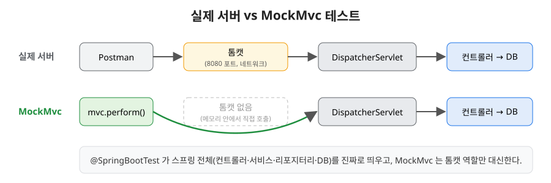

모든 컨트롤러 테스트는 **"1. 요청을 날린다 → 2. 결과를 검증한다"** 2단계 구조입니다.
```java
// 1. 요청
ResultActions resultActions = mvc.perform(get("/api/v1/posts")).andDo(print());

// 2. 검증
resultActions
        .andExpect(status().isOk())
        .andExpect(handler().methodName("getItems"))      // 어떤 메서드가 처리했는지
        .andExpect(jsonPath("$.length()").value(3))       // 응답 JSON 검사
        .andExpect(jsonPath("$[0].title").value("제목 3"));
```

| 기능 | 🔴 Red | 🟢 Green | 핵심 개념 |
|---|---|---|---|
| 테스트 준비 | [`008`](https://github.com/Minse5k/practice-springbootTDD2/commit/008) | | `@SpringBootTest`, `@AutoConfigureMockMvc`, `@Transactional` 롤백 |
| 다건조회 | [`009`](https://github.com/Minse5k/practice-springbootTDD2/commit/009) 404 | [`010`](https://github.com/Minse5k/practice-springbootTDD2/commit/010) | Controller → Service → Repository, DTO, 쿼리 메서드 |
| 단건조회 | [`011`](https://github.com/Minse5k/practice-springbootTDD2/commit/011) 404 | [`012`](https://github.com/Minse5k/practice-springbootTDD2/commit/012) | `@PathVariable`, `Optional` |
| 없는 글 → 404 | [`013`](https://github.com/Minse5k/practice-springbootTDD2/commit/013) 예외 | [`014`](https://github.com/Minse5k/practice-springbootTDD2/commit/014) | `@RestControllerAdvice`, `@ExceptionHandler`, `RsData` |
| 작성 | [`015`](https://github.com/Minse5k/practice-springbootTDD2/commit/015) 405 | [`016`](https://github.com/Minse5k/practice-springbootTDD2/commit/016) | `@RequestBody`, 201 Created, `RsData<T>` 제네릭 |
| 빈 제목 → 400 | [`017`](https://github.com/Minse5k/practice-springbootTDD2/commit/017) 201 | [`018`](https://github.com/Minse5k/practice-springbootTDD2/commit/018) | `@NotBlank` + `@Valid`, `MethodArgumentNotValidException` |
| 수정 | [`019`](https://github.com/Minse5k/practice-springbootTDD2/commit/019) 405 | [`020`](https://github.com/Minse5k/practice-springbootTDD2/commit/020) | setter 대신 `modify()`, **변경 감지(Dirty Checking)** |
| 삭제 | [`021`](https://github.com/Minse5k/practice-springbootTDD2/commit/021) 405 | [`022`](https://github.com/Minse5k/practice-springbootTDD2/commit/022) 🔴 FK 위반 → [`023`](https://github.com/Minse5k/practice-springbootTDD2/commit/023) | `@OneToMany(mappedBy)`, `cascade = REMOVE` |

#### 🔴 Red 는 이렇게 생겼다 — 009 실행 결과
컨트롤러가 아직 없으니 `200` 을 기대했지만 `404` 가 왔다. **"예상한 이유로" 실패하는지** 확인하는 것이 Red 단계의 핵심입니다.

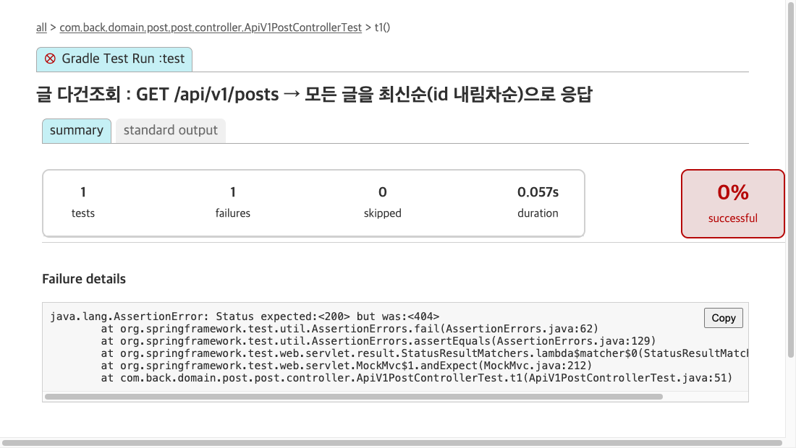

#### 실패 상태 코드로 읽는 "지금 무엇이 없는가"
| 받은 코드 | 의미 | 나온 커밋 |
|---|---|---|
| `404` + `No static resource` | 그 **URL** 을 처리하는 컨트롤러 자체가 없다 | 009, 011, 025, 027 |
| `405` + `Allow: GET` | URL 은 있는데 그 **HTTP 메서드**(POST/PUT/DELETE)가 없다 | 015, 019, 021, 029, 032, 034 |
| `ServletException: NoSuchElementException` | 처리되지 않은 예외가 그대로 터졌다 (실서버라면 500) | 013 |

#### 022 → 023 : "선택"이라던 DB 확인이 버그를 잡았다
글 삭제를 구현하니 응답은 `200` 인데 테스트가 실패했습니다. 1번 글에 달린 댓글 3개가 `post_id = 1` 로 글을 참조하고 있어서 DB 가 `DELETE` 를 거부한 것입니다.
응답만 검사했다면 놓쳤을 버그를, 테스트 마지막의 `assertThat(postRepository.count())` 가 잡아냈습니다.

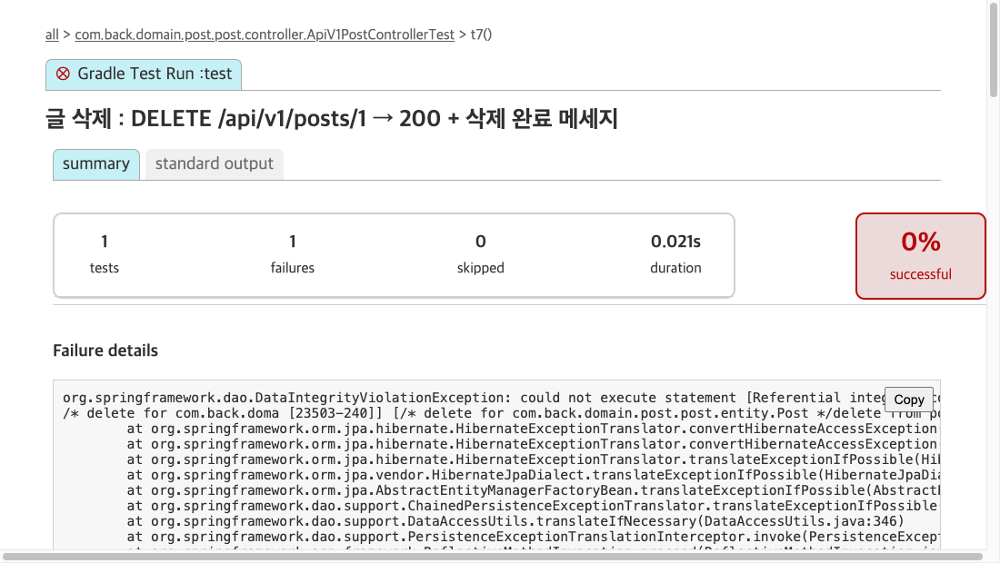

#### JPA 쓰기 지연 — 022 와 030 은 같은 원인
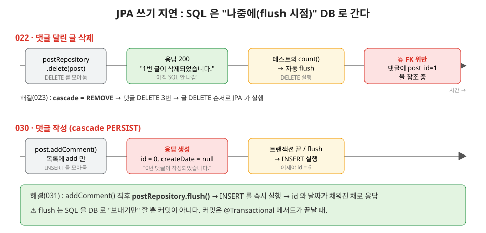

### 4부. 댓글 API by TDD (024 ~ 035)

댓글은 글에 **소속된** 리소스이므로 URL 도 `/api/v1/posts/{postId}/comments` 처럼 계층형으로 설계했습니다.
작성 / 수정 / 삭제는 모두 **글을 먼저 찾고, 글을 통해서** 댓글을 다룹니다. 그래서 다른 글의 댓글을 건드리는 실수가 구조적으로 불가능합니다.

```java
Post post = postRepository.findById(postId).get();          // 글이 없으면 404
PostComment postComment = post.findCommentById(id).get();  // 그 글의 댓글이 아니면 404
```

| 기능 | 🔴 Red | 🟢 Green | 핵심 개념 |
|---|---|---|---|
| 테스트 준비 | [`024`](https://github.com/Minse5k/practice-springbootTDD2/commit/024) | | 계층형 URL 설계 |
| 다건조회 | [`025`](https://github.com/Minse5k/practice-springbootTDD2/commit/025) 404 | [`026`](https://github.com/Minse5k/practice-springbootTDD2/commit/026) | `PostCommentDto`(postId 만 노출), OSIV |
| 단건조회 | [`027`](https://github.com/Minse5k/practice-springbootTDD2/commit/027) 404 | [`028`](https://github.com/Minse5k/practice-springbootTDD2/commit/028) | 경로 변수 2개, `Post.findCommentById` (소속 검사) |
| 작성 | [`029`](https://github.com/Minse5k/practice-springbootTDD2/commit/029) 405 | [`030`](https://github.com/Minse5k/practice-springbootTDD2/commit/030) 🔴 id=0 → [`031`](https://github.com/Minse5k/practice-springbootTDD2/commit/031) | `cascade = PERSIST`, `addComment`, **`flush()`** |
| 수정 | [`032`](https://github.com/Minse5k/practice-springbootTDD2/commit/032) 405 | [`033`](https://github.com/Minse5k/practice-springbootTDD2/commit/033) | `PostComment.modify`, 변경 감지 |
| 삭제 | [`034`](https://github.com/Minse5k/practice-springbootTDD2/commit/034) 405 | [`035`](https://github.com/Minse5k/practice-springbootTDD2/commit/035) | `orphanRemoval = true` |

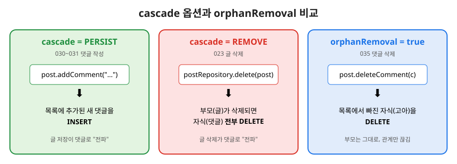

---

## 최종 테스트 결과

`./gradlew test` → **17개 테스트 모두 통과**

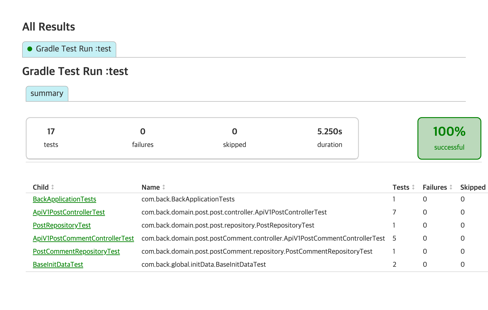

<details>
<summary>글 API 테스트 (7개)</summary>

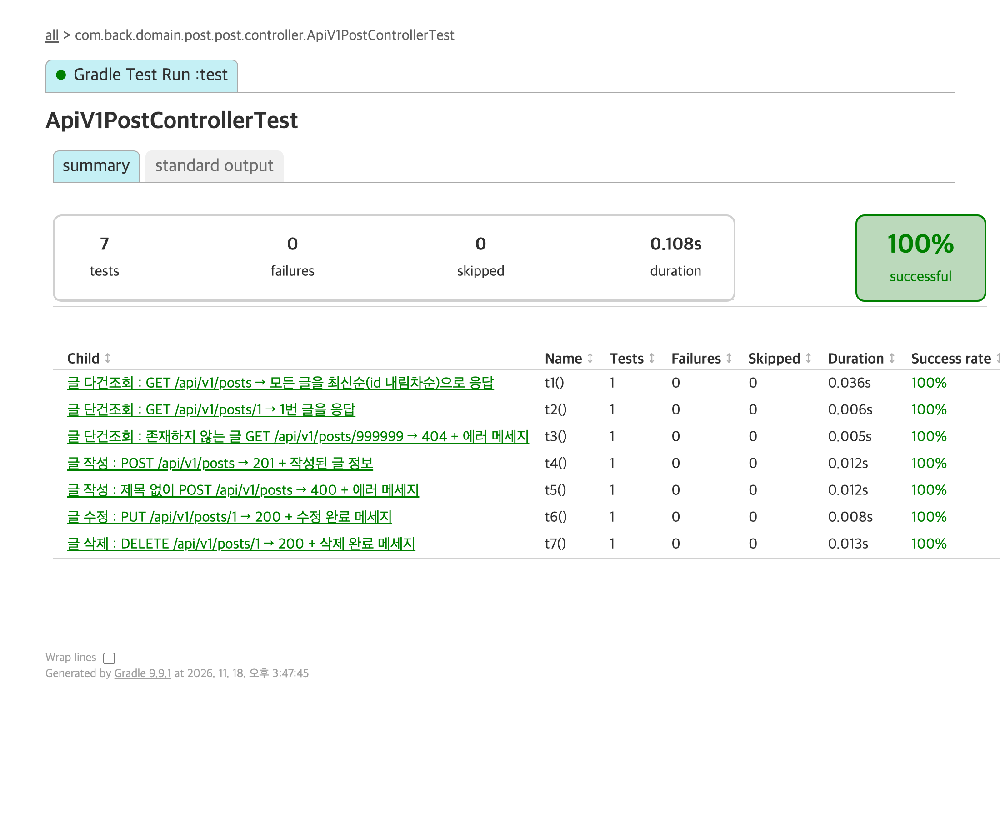
</details>

<details>
<summary>댓글 API 테스트 (5개)</summary>

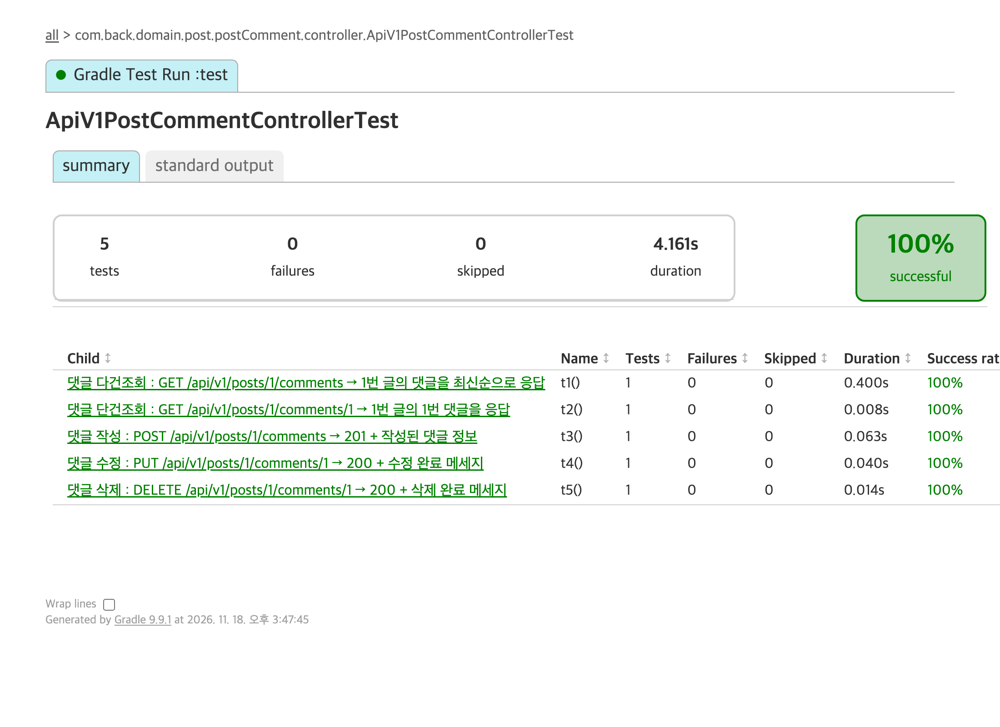
</details>

---

## 핵심 개념 정리

<details>
<summary><b>왜 테스트를 먼저 쓰나? (TDD)</b></summary>

- 테스트 = "요구사항을 코드로 적은 것". 무엇을 만들지 먼저 정하고 구현한다.
- 테스트에 적은 `handler().methodName("getItems")`, 응답 필드, 정렬 순서가 곧 **구현해야 할 목록**이 된다.
- Green 단계에서는 "지금 실패하는 테스트를 통과시키는 최소한의 코드"만 쓴다. 새 요구사항(예: 404, 400)은 새 테스트로 시작한다.
- 테스트가 쌓이면 리팩토링(005)이나 전역 변경도 두렵지 않다.
</details>

<details>
<summary><b>왜 응답 JSON 의 모든 필드를 검사하나?</b></summary>

- 프론트 개발자는 응답 필드를 믿고 화면을 만든다. 누군가 실수로 필드를 빼거나 이름을 바꾸면 테스트가 바로 잡아준다.
- 테스트 자체가 API 문서 역할을 한다.
- DB 까지 확인하는 것은 "선택"이지만, 삭제처럼 다른 데이터와 얽힌 기능에서는 큰 가치가 있다. (022)
</details>

<details>
<summary><b>왜 엔티티를 그대로 응답하지 않고 DTO 로 바꾸나?</b></summary>

- 엔티티에 민감한 필드가 추가되면 그대로 노출될 위험
- 엔티티 구조가 바뀌면 API 응답도 같이 바뀌어 프론트가 깨짐
- LAZY 연관관계를 JSON 으로 바꾸다 예외나 무한 순환(Post → comments → post → …)이 생길 수 있음
</details>

<details>
<summary><b>변경 감지(Dirty Checking) — save() 없이 UPDATE 되는 이유</b></summary>

1. 트랜잭션 안에서 조회한 엔티티는 JPA 가 관리하며, 처음 상태를 스냅샷으로 기억한다.
2. `post.modify(...)` 로 값을 바꾼다.
3. 트랜잭션이 끝날 때 스냅샷과 비교해서 달라졌으면 UPDATE 를 자동 실행한다.

실제 서버 로그 (020 커밋 메세지 참고)
```sql
select ... from post p1_0 where p1_0.id=?
update post set content=?, create_date=?, modify_date=?, title=? where id=?
```
</details>

<details>
<summary><b>테스트의 @Transactional 과 롤백</b></summary>

- 테스트 클래스에 `@Transactional` 을 붙이면 각 테스트가 끝날 때 롤백된다. → 삭제 테스트를 해도 다음 테스트에는 글 3개가 그대로 있다.
- 단, DB 의 자동 증가 번호(IDENTITY)는 롤백돼도 되돌아가지 않는다. 그래서 테스트에서 "4번 글" 처럼 번호를 하드코딩하지 않고 DB 에서 실제 id 를 꺼내 비교한다. (017)
- 롤백되기 때문에 테스트에서는 UPDATE SQL 이 아예 나가지 않을 수도 있다. 실제 반영은 서버를 띄워 확인했다. (020)
</details>

<details>
<summary><b>HTTP 상태 코드와 resultCode</b></summary>

| 상태 코드 | 의미 | resultCode |
|---|---|---|
| 200 OK | 성공 (조회, 수정, 삭제) | `200-1` |
| 201 Created | 성공 + 새 리소스 생성 | `201-1` |
| 400 Bad Request | 요청한 쪽 잘못 (입력값 검증 실패) | `400-1` |
| 404 Not Found | 데이터 없음 | `404-1` |
| 405 Method Not Allowed | URL 은 있는데 HTTP 메서드가 없음 | — |

`resultCode` 는 "HTTP상태코드-세부번호" 형식이라, 같은 404 라도 원인별로 프론트가 분기할 수 있다.
</details>
